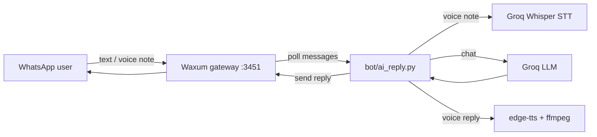

# Waxum WhatsApp AI

A self-hosted WhatsApp assistant that replies to text and voice notes in casual Hinglish, powered by the [Waxum](https://hub.docker.com/r/fdciabdul/waxum) gateway and the free [Groq](https://console.groq.com) API.

## Features

- **Text replies** – answers incoming WhatsApp messages using a Groq chat model.
- **Voice-note replies** – transcribes voice notes with Groq Whisper (STT) and replies with a voice note generated by Microsoft Edge TTS (`edge-tts`), sent as push-to-talk audio.
- **Allowlist** – the bot only replies to numbers you list; everyone else is ignored.
- **Custom persona** – define the bot's tone and facts in a plain-text file.
- **Hinglish support** – replies in romanized Hinglish (no Devanagari), with Hindi-tuned speech recognition.
- **Polite mode** – optional softer tone for specific numbers (`RESPECTFUL_NUMBERS`).
- **Experimental live calls** – `bot/voice_agent.py` can talk on WhatsApp calls (latency and accuracy are limited; voice notes work better).

## How it works



## Prerequisites

- Linux (or WSL) with **Python 3.10+**
- **ffmpeg** and **curl** installed (`sudo apt install ffmpeg curl`)
- **Docker** + Docker Compose (to run the Waxum gateway)
- A free **Groq API key** – <https://console.groq.com/keys>
- A **spare WhatsApp number** (not your main one – see Security)

## Installation

```bash
git clone https://github.com/iamdudeGH/waxum-whatsapp-ai.git
cd waxum-whatsapp-ai
python3 -m venv .venv
source .venv/bin/activate
pip install -r requirements.txt
```

## Configuration

1. **Environment file**
   ```bash
   cp .env.example .env
   ```
   Edit `.env` and set at least `GROQ_API_KEY`. The top half configures the Waxum gateway; the bottom half configures the bot.

   | Variable | Default | Purpose |
   |---|---|---|
   | `GROQ_API_KEY` | – (required) | Groq API key |
   | `WAXUM_URL` | `http://127.0.0.1:3451` | Waxum API address |
   | `WAXUM_SESSION` | `main` | Waxum session name |
   | `WAXUM_TOKEN_FILE` | `./superadmin.token` | File containing the Waxum API token |
   | `GROQ_MODEL` | `qwen/qwen3.8-27b` | Chat model |
   | `MAX_TOKENS` | `160` | Max reply length |
   | `CHAT_HISTORY` | `4` | Previous messages kept as context |
   | `POLL_SECS` | `0.4` | How often to poll for new messages |
   | `RESPECTFUL_NUMBERS` | empty | Comma-separated numbers that get a polite tone |
   | `STT_MODEL` | `whisper-large-v3` | Speech-to-text model |
   | `STT_LANG` | `hi` | STT language hint |
   | `TTS_VOICE` | `en-IN-PrabhatNeural` | Edge TTS voice for voice notes |

   Live-call tuning variables (`TTS_RATE`, `EDGE_TTS_BIN`, `ECHO_TAIL_S`, `BARGE_*`, `SPEECH_RMS`, `*_SPEECH_MS`, …) are listed in `.env.example`.

2. **Persona**
   ```bash
   cp bot/persona.txt.example bot/persona.txt
   ```
   Write how the bot should talk and any facts it may share.

3. **Allowlist**
   ```bash
   cp bot/allowlist.txt.example bot/allowlist.txt
   ```
   One number per line, country code + digits only (e.g. `91XXXXXXXXXX`). An empty list means the bot replies to nobody.

`.env`, `persona.txt`, `allowlist.txt` and token files are git-ignored so your private data is never committed.

## Linking WhatsApp (QR code)

1. Start the gateway: `docker compose up -d`
2. Open the Waxum API docs at `http://127.0.0.1:3451` and, using your API token, create a session named `main` (or whatever you set in `WAXUM_SESSION`) and request its QR code.
3. On the spare phone: **WhatsApp → Settings → Linked devices → Link a device**, then scan the QR.
4. Save the Waxum API token into `superadmin.token` (or the path in `WAXUM_TOKEN_FILE`).

## Running and stopping

```bash
source .venv/bin/activate
set -a; . ./.env; set +a
cd bot
nohup python3 ai_reply.py > nohup.out 2>&1 &   # start (text + voice notes)
tail -f bot.log                                # watch activity
pkill -f ai_reply.py                           # stop
```

Experimental live calls: `python3 bot/voice_agent.py` (stop with `Ctrl+C` or `pkill -f voice_agent.py`).

## Troubleshooting

| Problem | Cause / fix |
|---|---|
| Allowlisted number gets no reply | WhatsApp may send a `@lid` ID instead of a phone number. The bot resolves it through Waxum's contacts LID endpoint; check `bot.log` for `skip_not_allowlisted` and make sure the number in `allowlist.txt` has the country code and no `+` or spaces. |
| Empty / no reply from the model | Some models return blank content. The bot retries once and falls back to a short reply. If it keeps happening, switch `GROQ_MODEL` (the default `qwen/qwen3.8-27b` works well). |
| Voice note transcribed in the wrong language | Auto-detection can mistake Hinglish for other languages. Keep `STT_LANG=hi`. |
| TTS crashes or is silent | The `en-IN` voices cannot speak Devanagari. Keep the persona asking for roman-letter Hinglish; the bot also strips Hindi script before speaking. |
| `KeyError: 'GROQ_API_KEY'` | The `.env` was not loaded – run `set -a; . ./.env; set +a` first. |

## Project structure

| Path | Description |
|---|---|
| `bot/ai_reply.py` | Main worker: polls Waxum, filters by allowlist, replies to text and voice notes |
| `bot/voice_note.py` | Voice-note pipeline: download → Whisper STT → edge-tts → ogg/opus send |
| `bot/voice_agent.py` | Experimental real-time call agent |
| `bot/persona.txt.example` | Persona template |
| `bot/allowlist.txt.example` | Allowlist template |
| `.env.example` | Gateway + bot configuration template |
| `docker-compose.yml` | Runs the Waxum gateway and NATS |
| `requirements.txt` | Python dependencies |
| `LICENSE` | MIT license |

## Security notes

- Waxum is an **unofficial** WhatsApp gateway. Automated use can get a number **banned** – use a spare number only.
- **Never commit** `.env`, token files, `persona.txt`, `allowlist.txt`, session folders or logs (already in `.gitignore`).
- Keep the Waxum API bound to localhost or behind authentication.
- Only allowlist people who have agreed to talk to a bot.

## Disclaimer

This project is not affiliated with WhatsApp, Meta, Groq or Microsoft. Use it at your own risk and in line with each service's terms.

## License

[MIT](LICENSE) © waxum-whatsapp-ai contributors
